# Ethereum Network Activity Forecasting: A Comparative Study of Statistical, Machine Learning, and Deep Learning Models (2015–2026)

*Research report*

## Abstract

Accurate forecasting of Ethereum network activity is relevant to understanding changes in blockchain usage and the operational dynamics of a public blockchain. This study examines daily transaction counts from the Ethereum mainnet between 1 October 2015 and 17 November 2026, producing 4,066 daily observations from Google BigQuery’s public blockchain dataset. The analysis combines exploratory time-series analysis, stationarity testing, statistical forecasting, and machine-learning and deep-learning models. The data were divided chronologically into training (2,846 observations), validation (610), and test (610) periods. Naïve and seasonal-naïve forecasts were used as benchmarks; ARIMA and SARIMA models were evaluated on the validation period; and random forest (RF), XGBoost, multilayer perceptron (MLP), and long short-term memory (LSTM) models were assessed using fixed-origin and rolling-origin validation, followed by rolling one-step-ahead testing. The original series was non-stationary according to complementary ADF and KPSS tests, while first-order differencing produced a stationary series under the reported tests. On the final test period, LSTM achieved the lowest error among the four machine-learning and deep-learning models (MAE 188,525.83; RMSE 274,566.22; MAPE 9.38%). Forecast errors increased for all four models in the 2026 portion of the test period compared with the 2025 portion. These findings are specific to the selected observation period, target variable, feature set, and evaluation design; they do not establish that one model will dominate for other Ethereum metrics or future regimes.

Keywords: Ethereum; blockchain analytics; transaction counts; time-series forecasting; ARIMA; random forest; XGBoost; multilayer perceptron; LSTM

## 1. Introduction

Public blockchains generate time-stamped transaction records that can be aggregated into activity indicators and analysed as time series. Daily transaction counts provide a direct measure of the number of transactions represented in the selected transaction table. They can help describe broad changes in network usage, although they do not capture every form of on-chain execution or every dimension of network demand.

Ethereum activity is shaped by changing applications, user behaviour, protocol conditions, market cycles, and other factors. These dynamics can produce trend changes, volatility, and temporal dependence, making forecasting challenging. A useful forecasting study should therefore compare multiple model families, preserve temporal order during validation, and distinguish between forecasts made without observing future actual values and forecasts updated as new observations arrive.

This report compares benchmark, statistical, machine-learning, and deep-learning approaches for forecasting daily Ethereum transaction counts. It focuses on the empirical forecasting performance under the stated data split and evaluation procedures. The analysis does not attempt to identify causal drivers of transaction activity.

## 2. Data and Methods

### 2.1 Data source and target variable

The source is the Google BigQuery public table `bigquery-public-data.goog_blockchain_ethereum_mainnet.transactions`. The study period runs from 1 October 2015 through 17 November 2026, inclusive. Daily counts were aggregated in UTC, using an exclusive upper timestamp of 18 November 2026 at 00:00:00 UTC. The resulting series contains 4,066 daily observations.

The target is the number of transaction records per UTC calendar day in the selected table. The table represents transactions initiated by externally owned accounts (EOAs); it should not be interpreted as a complete count of all internal EVM execution steps, traces, or contract-level operations. The SQL included in the project repository documents a reconstruction of the daily aggregation; it is not asserted to be a byte-for-byte copy of the original executed query.

Dataset schema documentation: https://docs.cloud.google.com/blockchain-analytics/docs/schema

### 2.2 Chronological data partitioning

| Partition | Observations | Start date | End date |

| --- | --- | --- | --- |

| Training | 2,846 | 2015-10-01 | 2023-07-16 |

| Validation | 610 | 2023-07-17 | 2025-03-17 |

| Test | 610 | 2025-03-18 | 2026-11-17 |

| Total | 4,066 | 2015-10-01 | 2026-11-17 |

The split preserves chronological order. Model selection and validation are based on the training and validation periods. The final test period is used for the reported final comparison of RF, XGBoost, MLP, and LSTM.

### 2.3 Exploratory analysis

Exploratory analysis examined the distribution of daily counts, the daily series, a 30-day rolling mean, rolling volatility, boxplots, average counts by weekday and month, and a monthly activity heatmap. The full-period mean was approximately 948,350 transactions per day, the median approximately 1,052,374, and the standard deviation approximately 578,309. Daily counts ranged from 5,830 to 3,627,491.

The mean 30-day rolling standard deviation was approximately 83,405. It ranged from approximately 516 on 30 October 2015 to approximately 587,070 on 10 May 2026. The first and third quartiles were approximately 579,613 and 1,219,666, respectively; the IQR was approximately 640,053, giving an upper Tukey fence of approximately 2,179,746. There were 126 potential upper outliers (about 3.1%). These observations were retained because high activity values may represent genuine network behaviour rather than data errors.

Average activity varied across weekdays and months. Tuesday had the highest reported weekday average (approximately 977,870), while Sunday had the lowest (approximately 886,207), about 9.4% lower than Tuesday. August had the highest reported monthly average (approximately 1,027,469), while December had the lowest (approximately 869,175), making August approximately 18.2% higher. Monthly differences were not consistent from year to year; these descriptive differences should not be interpreted as proof of stable annual seasonality.

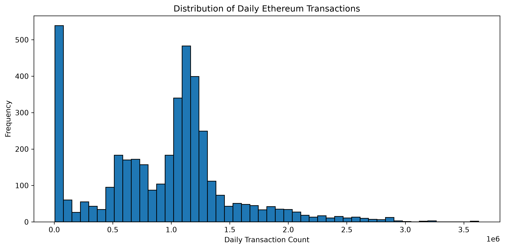

Figure 1. Distribution of daily Ethereum transaction counts.

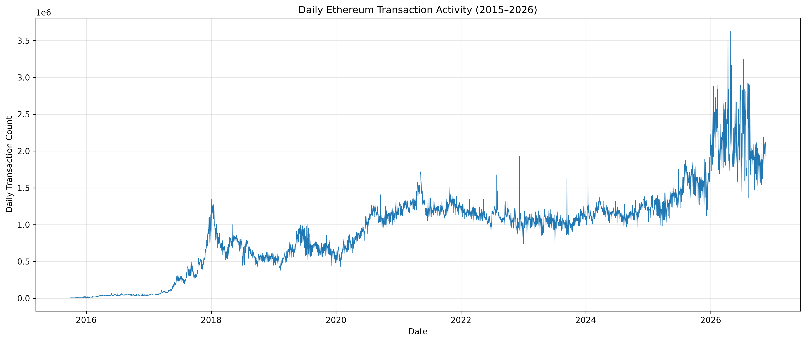

Figure 2. Daily Ethereum transaction activity across the observation period.

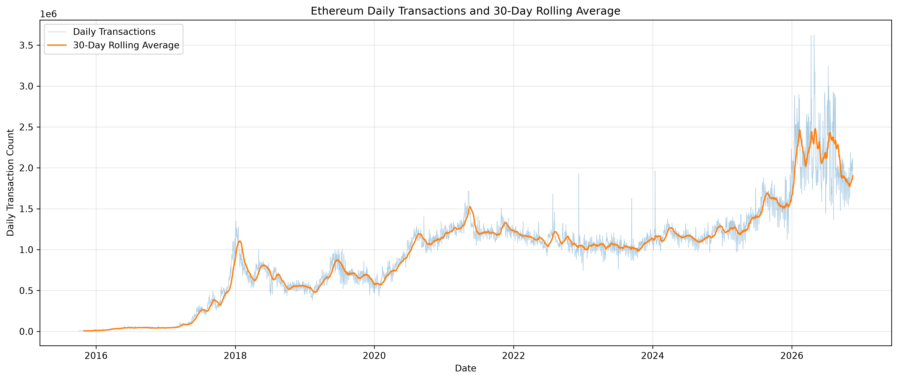

Figure 3. Thirty-day rolling average of daily transaction counts.

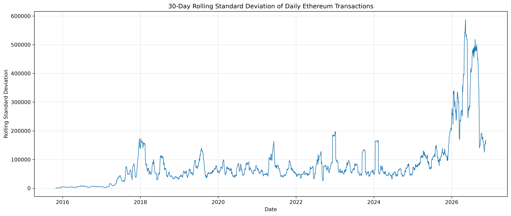

Figure 4. Rolling volatility of transaction activity, measured using a 30-day rolling standard deviation.

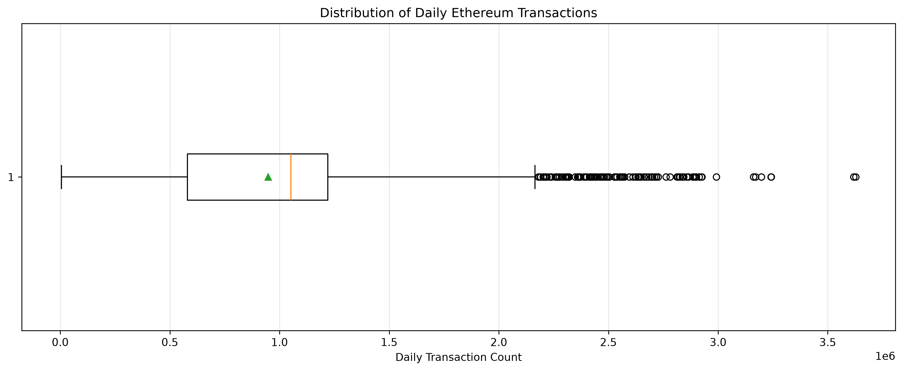

Figure 5. Boxplot of daily transaction counts.

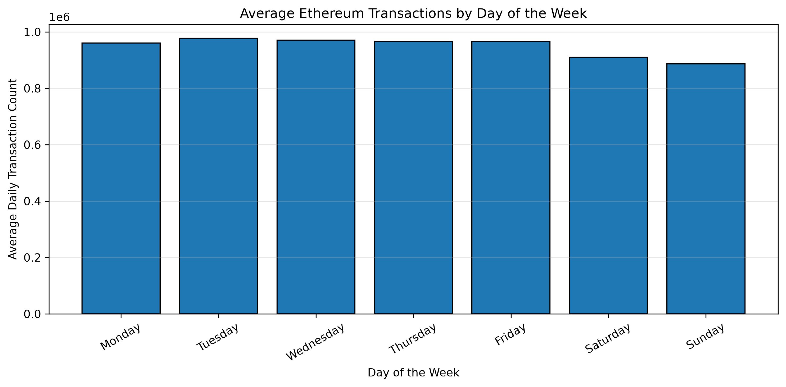

Figure 6. Average daily transaction counts by weekday.

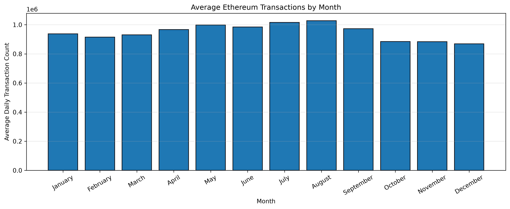

Figure 7. Average daily transaction counts by calendar month.

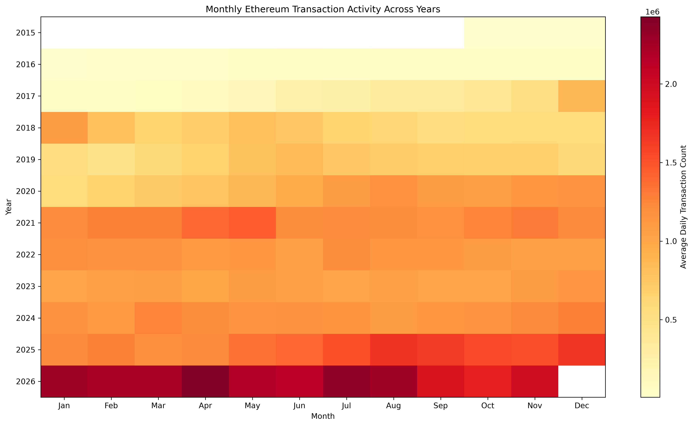

Figure 8. Monthly transaction activity heatmap.

### 2.4 Stationarity assessment and differencing

The Augmented Dickey–Fuller (ADF) and Kwiatkowski–Phillips–Schmidt–Shin (KPSS) tests were used as complementary stationarity diagnostics. For the original series, the ADF statistic was −1.1536 (p = 0.6932; 29 lags), so the unit-root null was not rejected. The KPSS statistic was 8.0221 (reported p = 0.01), rejecting the stationarity null. Together, the results support treating the original series as non-stationary.

After first-order differencing, the series contained 4,065 observations, with a mean daily change of approximately 519, a median of −41, and a standard deviation of approximately 113,071. The ADF statistic was −12.6213 (p approximately 1.58 × 10⁻²³), while the KPSS statistic was 0.0560 (reported p = 0.10, the upper reporting bound). These results support first-order differencing for the statistical models.

Weekly seasonal differencing at lag 7 was also explored because autocorrelation diagnostics indicated weekly dependence. Combined ordinary and weekly seasonal differencing produced a strong negative autocorrelation at lag 7, which can be a sign of possible over-differencing. Ordinary first-order differencing was therefore retained for the statistical model specifications described below.

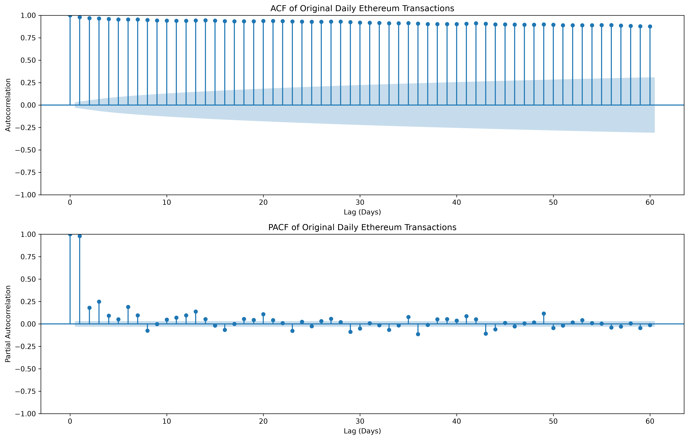

Figure 9. ACF and PACF of the original transaction-count series.

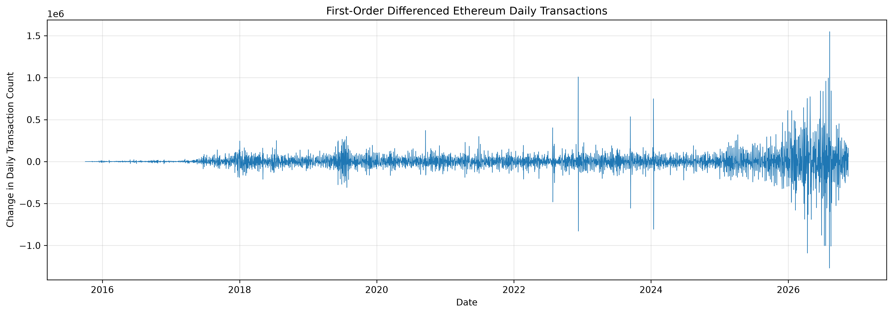

Figure 10. First-order differenced transaction-count series.

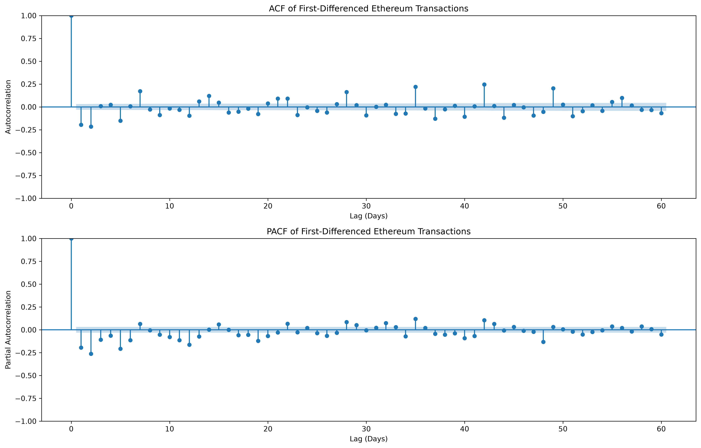

Figure 11. ACF and PACF of the first-order differenced series.

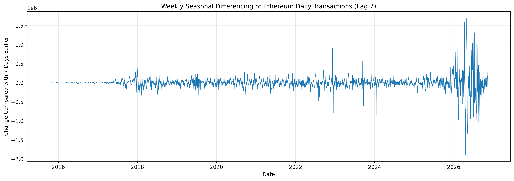

Figure 12. Weekly seasonal differencing (lag 7).

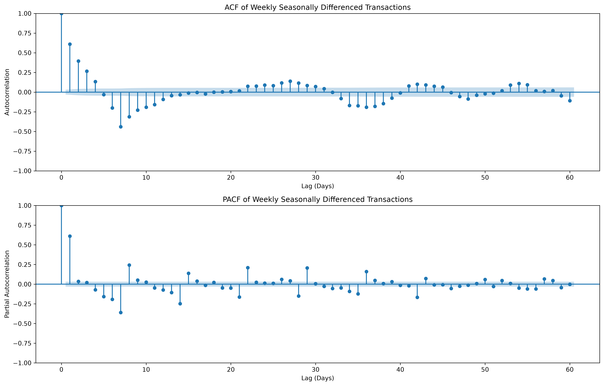

Figure 13. ACF and PACF after weekly seasonal differencing.

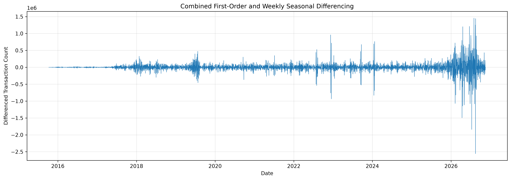

Figure 14. Combined ordinary and weekly seasonal differencing.

### 2.5 Forecasting models

#### 2.5.1 Benchmarks

Two benchmark forecasts were considered: a naïve forecast, which carries the most recent observation forward, and a seasonal-naïve forecast with a period of seven days, which uses the value from the corresponding weekday in the previous week.

#### 2.5.2 ARIMA and SARIMA

The evaluated ARIMA specifications were (1,1,0), (0,1,1), and (1,1,1). The evaluated SARIMA specifications were (1,1,1)(1,0,0,7), (1,1,1)(0,0,1,7), and (1,1,1)(1,0,1,7). Model fit was compared using AIC and BIC, and validation forecast errors were also examined. Information criteria and out-of-sample forecast accuracy were treated as distinct selection considerations.

#### 2.5.3 Random forest

The RF feature set included lagged counts at lags 1, 7, 14, and 28; 7-day and 30-day rolling means; a 7-day rolling standard deviation; and calendar features for day of week, day of month, and month. Rolling features were shifted by one observation to prevent the target day's value from entering its predictors. The first 30 rows were excluded because of feature construction. The model used 100 trees, maximum depth 12, minimum samples per leaf 2, and random state 42.

#### 2.5.4 XGBoost

XGBoost used the same general lag and calendar feature framework. The configuration used 100 boosting rounds, maximum depth 6, learning rate 0.05, squared-error objective, random state 42, and one job.

#### 2.5.5 Multilayer perceptron

The MLP contained hidden layers of 32 and 16 units with ReLU activation and the Adam optimizer. The reported configuration used alpha 0.001, batch size 64, learning rate 0.001, maximum 300 iterations, early stopping disabled, and random state 42. Features were standardized using StandardScaler, and the target was standardized through a TransformedTargetRegressor.

#### 2.5.6 Long short-term memory network

The LSTM was implemented in PyTorch with one recurrent layer and 16 hidden units. It used a 30-day lookback window, Adam with learning rate 0.001, mean squared error loss, 20 epochs, batch size 32, and seed 42. For validation, MinMaxScaler was fitted on the 2,846 training observations, producing 2,816 supervised sequences. For the final model, a new scaler was fitted on the combined training and validation period (3,456 observations), producing 3,426 supervised sequences.

### 2.6 Validation and test design

Fixed-origin validation forecasts are generated from the information available at the forecast origin without incorporating actual validation observations as they arrive. For recursive machine-learning forecasts, future lag and rolling features are constructed using predictions. Rolling-origin validation instead predicts one day ahead, then incorporates the newly observed actual value before generating the next prediction. In the LSTM rolling-origin evaluation, model weights and the scaler remain fixed during the validation period.

For the final test comparison, RF, XGBoost, MLP, and LSTM were retrained using the combined training and validation data. Each model generated 610 rolling one-step-ahead predictions over the test period. An actual observation was incorporated only after its prediction had been made. Model weights and preprocessing parameters were fixed throughout the test period. Predictions were returned to the original transaction-count scale.

Fixed-origin and rolling-origin metrics answer different operational questions and are not directly comparable. Statistical models and benchmark forecasts were not evaluated on the final test period in the reported results; therefore, the final test ranking applies only to the four machine-learning and deep-learning models.

## 3. Results

### 3.1 Benchmark performance

| Benchmark | MAE | RMSE | MAPE (%) |

| --- | --- | --- | --- |

| Naïve | 203,493.25 | 228,642.32 | 17.06 |

| Seasonal naïve (7-day) | 120,320.34 | 151,445.25 | 10.07 |

The seasonal-naïve benchmark substantially outperformed the naïve benchmark on the validation period, indicating that a simple weekly reference pattern provided useful predictive information.

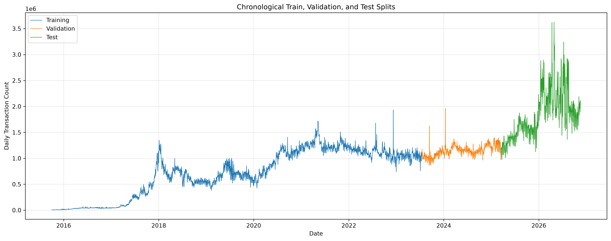

Figure 15. Chronological training, validation, and test partitions.

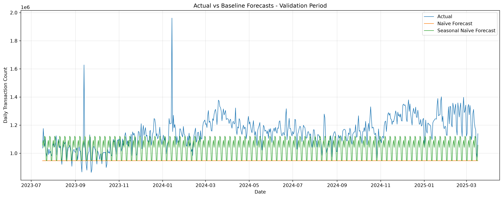

Figure 16. Fixed-origin benchmark forecast comparison.

### 3.2 ARIMA and SARIMA results

Among the ARIMA candidates, ARIMA(1,1,1) had the lowest AIC and BIC and the lowest validation errors of the three tested ARIMA specifications. Among the SARIMA candidates, SARIMA(1,1,1)(1,0,1,7) had the lowest AIC and BIC, but its validation forecast errors were higher than those of SARIMA(1,1,1)(1,0,0,7). This illustrates why information criteria alone do not determine out-of-sample forecast performance.

| ARIMA model | AIC | BIC | Validation MAE | Validation RMSE | MAPE (%) |

| --- | --- | --- | --- | --- | --- |

| (1,1,0) | 70,767.585 | 70,779.492 | 202,800.06 | 228,003.75 | 17.00 |

| (0,1,1) | 70,573.936 | 70,585.842 | 162,780.93 | 191,437.76 | 13.54 |

| (1,1,1) | 70,380.316 | 70,398.176 | 149,920.17 | 179,174.32 | 12.44 |

| SARIMA model | AIC | BIC | Validation MAE | Validation RMSE | MAPE (%) |

| --- | --- | --- | --- | --- | --- |

| (1,1,1)(1,0,0,7) | 70,263.231 | 70,287.045 | 142,453.43 | 171,900.79 | 11.81 |

| (1,1,1)(0,0,1,7) | 70,294.520 | 70,318.333 | 144,260.84 | 173,690.92 | 11.97 |

| (1,1,1)(1,0,1,7) | 69,905.017 | 69,934.783 | 197,541.59 | 231,279.15 | 16.48 |

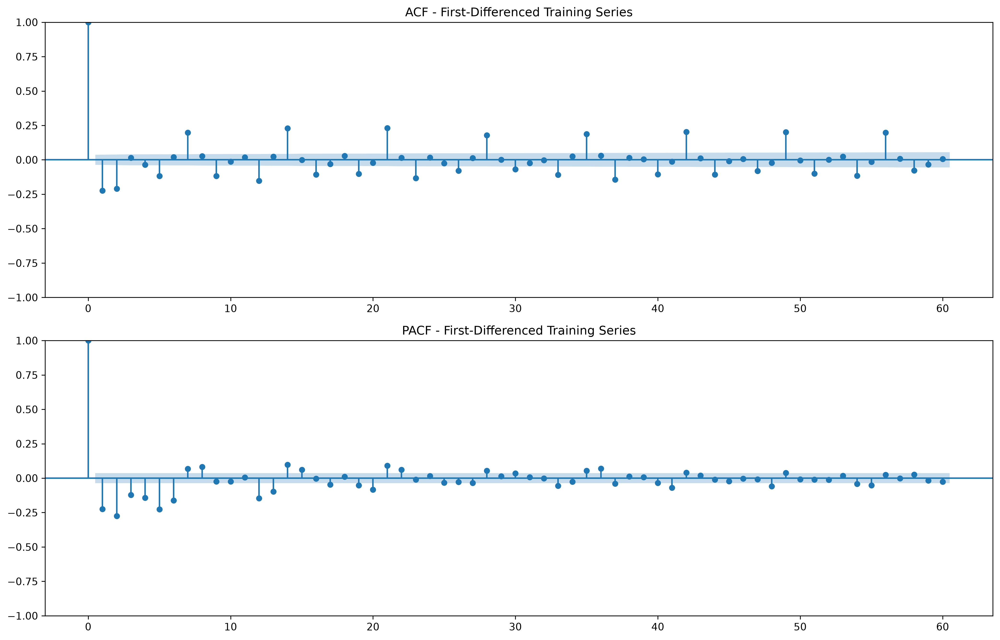

Figure 17. ACF and PACF of the ARIMA training series.

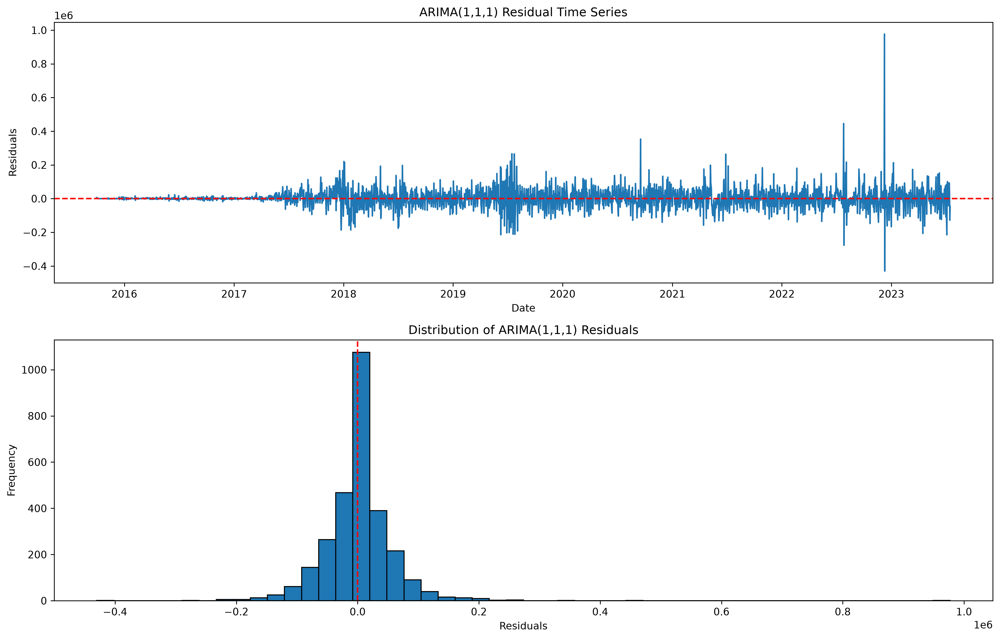

Figure 18. Residual diagnostics for the ARIMA model.

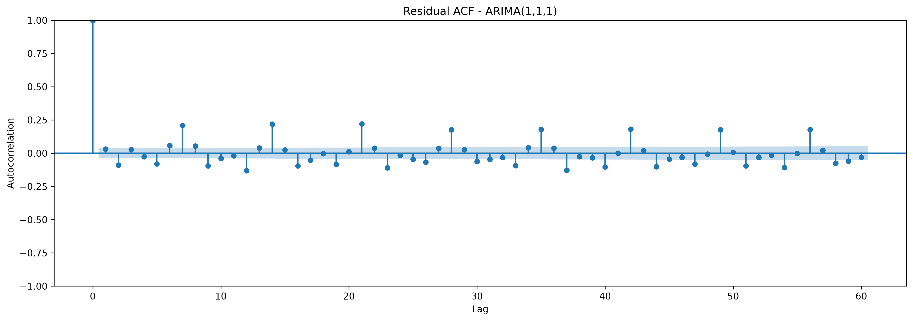

Figure 19. Autocorrelation of ARIMA residuals.

### 3.3 Fixed-origin machine-learning validation

Under the fixed-origin validation design, XGBoost achieved lower error than RF. RF recorded MAE 112,560.90, RMSE 141,552.36, and MAPE 9.36%; XGBoost recorded MAE 100,176.21, RMSE 127,874.17, and MAPE 8.34%. Both machine-learning models outperformed the statistical candidates and the seasonal-naïve benchmark on this fixed-origin validation comparison.

| Model | MAE | RMSE | MAPE (%) |

| --- | --- | --- | --- |

| Random forest | 112,560.90 | 141,552.36 | 9.36 |

| XGBoost | 100,176.21 | 127,874.17 | 8.34 |

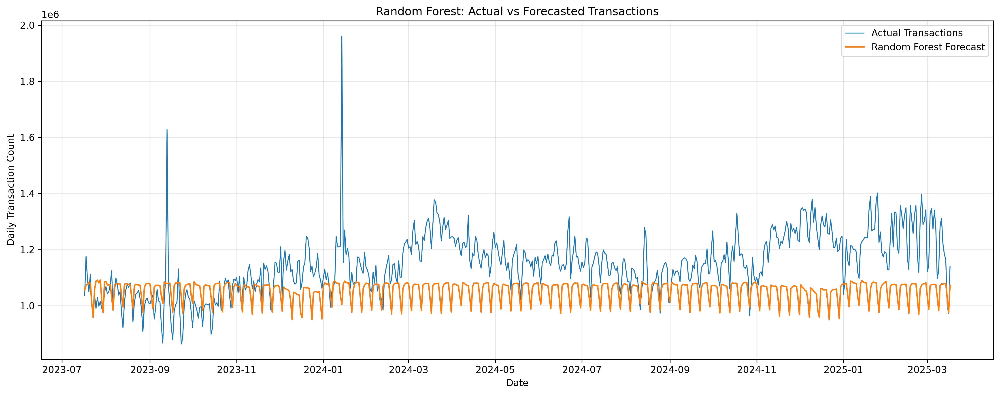

Figure 20. Random forest validation forecast.

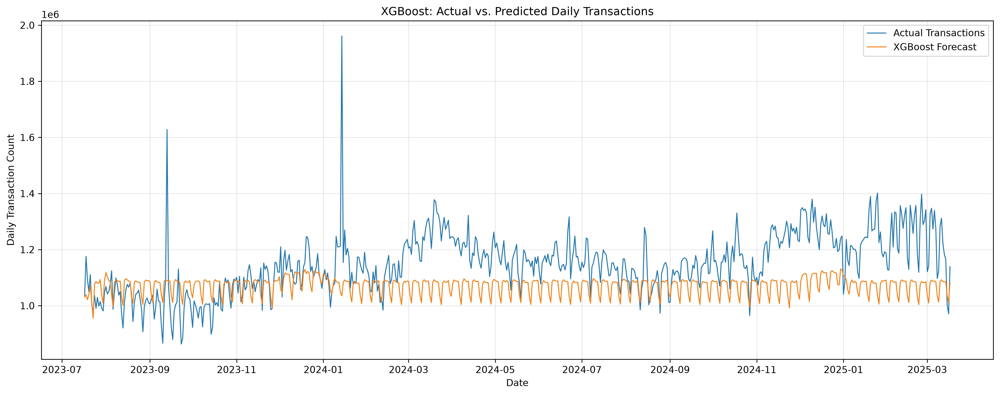

Figure 21. XGBoost validation forecast.

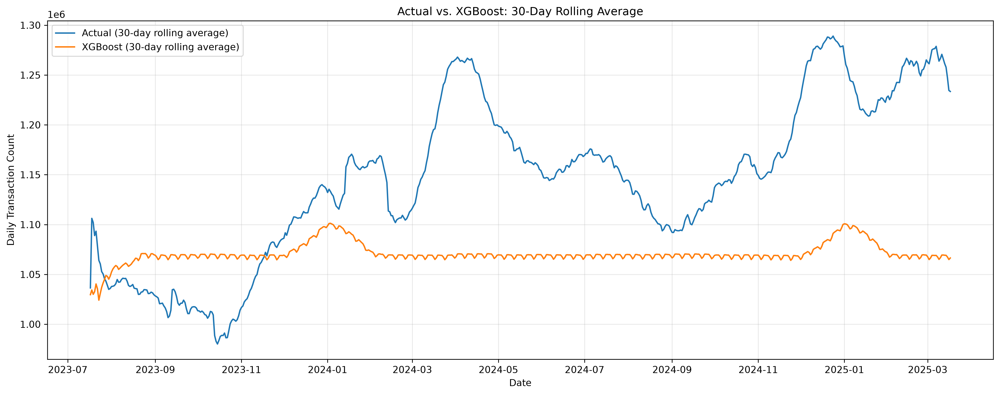

Figure 22. XGBoost forecast and 30-day rolling average.

### 3.4 Rolling-origin validation

Rolling-origin validation produced substantially lower errors for RF, XGBoost, and MLP than their fixed-origin forecasts, reflecting the different information available under one-step-ahead updating. XGBoost recorded MAE 40,767.35 and RMSE 64,079.55; RF recorded MAE 41,072.59 and RMSE 65,454.15; and MLP recorded MAE 40,993.44 and RMSE 67,193.78. MLP had the lowest MAPE (3.51%), narrowly below XGBoost (3.53%) and RF (3.55%). LSTM had higher rolling-origin validation errors (MAE 95,153.68; RMSE 117,271.46; MAPE 7.94%) than the other three models.

| Model | MAE | RMSE | MAPE (%) |

| --- | --- | --- | --- |

| XGBoost | 40,767.35 | 64,079.55 | 3.53 |

| Random forest | 41,072.59 | 65,454.15 | 3.55 |

| MLP | 40,993.44 | 67,193.78 | 3.51 |

| LSTM | 95,153.68 | 117,271.46 | 7.94 |

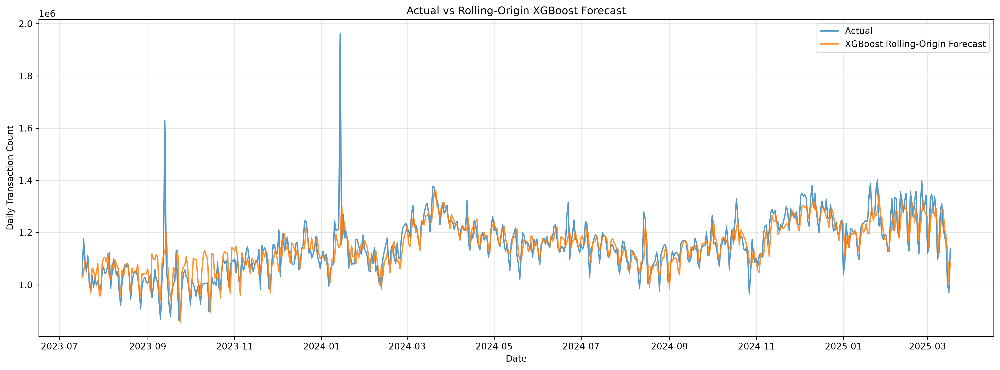

Figure 23. XGBoost rolling-origin validation forecast.

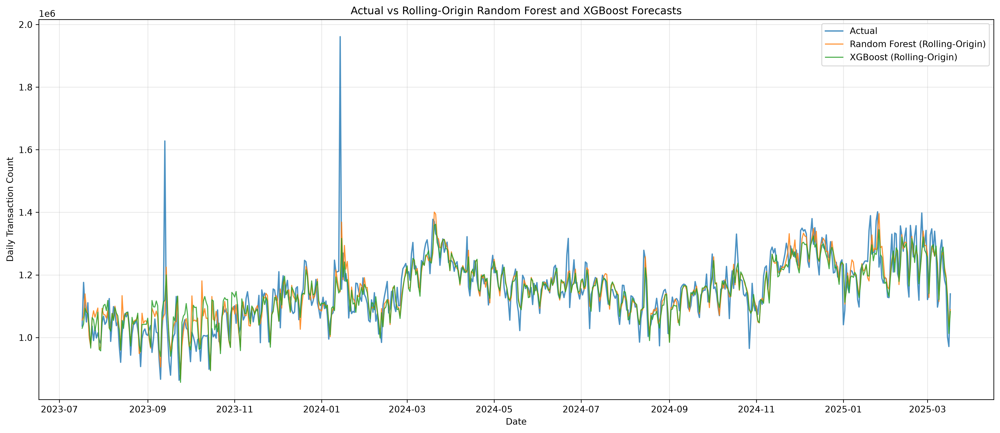

Figure 24. Rolling-origin random forest and XGBoost comparison.

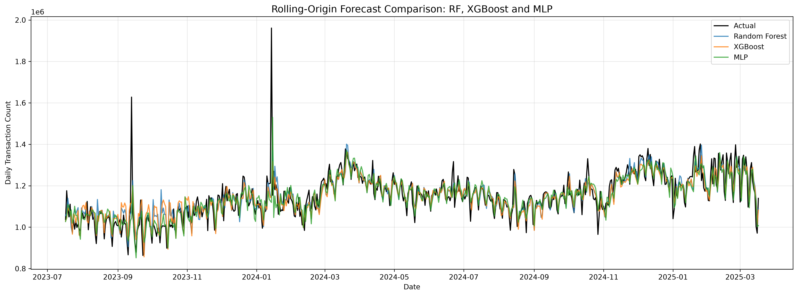

Figure 25. Rolling-origin random forest, XGBoost, and MLP comparison.

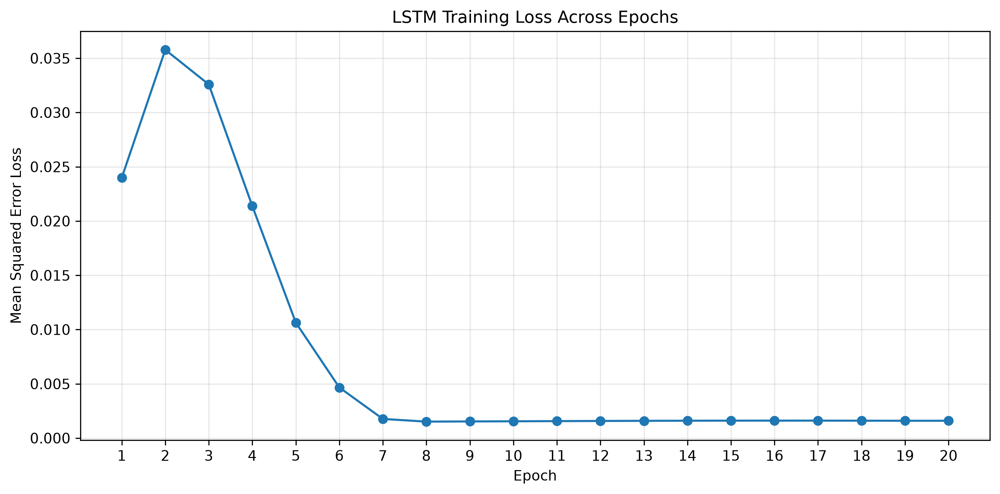

Figure 26. LSTM training loss over epochs.

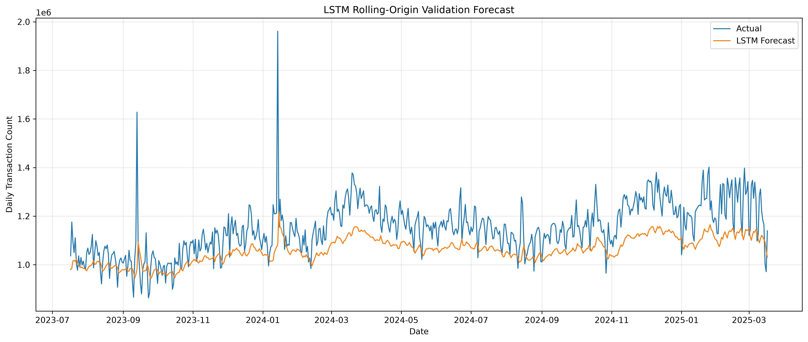

Figure 27. LSTM rolling-origin validation forecast.

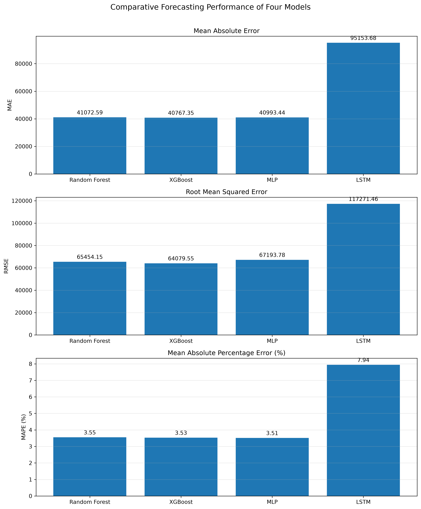

Figure 28. Validation performance comparison across four machine-learning and deep-learning models.

### 3.5 Final test performance

On the 610-observation final test period (18 March 2025 to 17 November 2026), LSTM achieved the lowest error among the four machine-learning and deep-learning models. Its MAE was 188,525.83, RMSE 274,566.22, and MAPE 9.38%. MLP ranked second, followed by RF and XGBoost. This ranking differs from the rolling-origin validation results, where LSTM had the highest error of the four models.

| Model | MAE | RMSE | MAPE (%) |

| --- | --- | --- | --- |

| LSTM | 188,525.83 | 274,566.22 | 9.38 |

| MLP | 240,435.88 | 357,392.41 | 11.51 |

| Random forest | 341,539.07 | 491,271.85 | 15.86 |

| XGBoost | 391,641.66 | 546,286.97 | 18.23 |

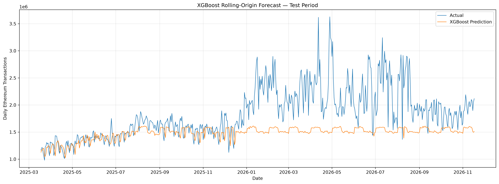

Figure 29. XGBoost predictions against observed transaction counts in the final test period.

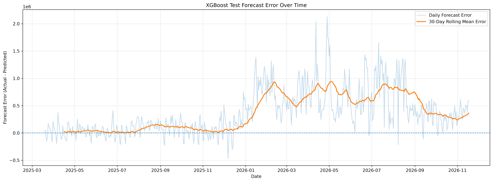

Figure 30. XGBoost test-period forecast errors.

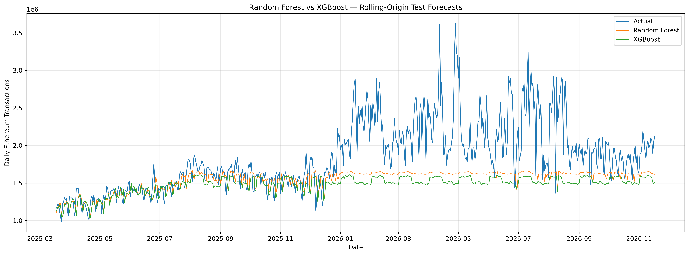

Figure 31. Random forest and XGBoost test-period comparison.

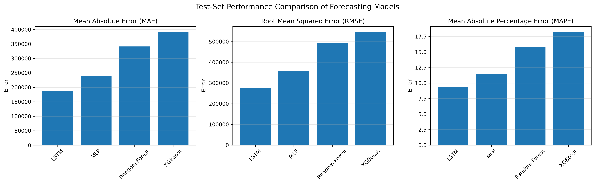

Figure 32. Consolidated test-period performance comparison.

### 3.6 Test performance by calendar year

The test interval spans part of 2025 and part of 2026; neither year is represented by a complete calendar year. The 2025 segment contains 289 observations (18 March–31 December), and the 2026 segment contains 321 observations (1 January–17 November). All four models recorded higher forecast errors in the 2026 segment than in the 2025 segment.

| Year segment | Model | MAE | RMSE | MAPE (%) |

| --- | --- | --- | --- | --- |

| 2025 (289 obs.) | LSTM | 99,156.34 | 129,349.27 | 6.73 |

| 2025 (289 obs.) | MLP | 118,188.67 | 155,735.40 | 7.78 |

| 2025 (289 obs.) | RF | 119,362.86 | 157,308.91 | 7.98 |

| 2025 (289 obs.) | XGBoost | 132,847.77 | 171,075.41 | 8.69 |

| 2026 (321 obs.) | LSTM | 268,986.19 | 358,042.92 | 11.76 |

| 2026 (321 obs.) | MLP | 350,496.45 | 469,989.16 | 14.87 |

| 2026 (321 obs.) | RF | 541,566.88 | 660,573.43 | 22.96 |

| 2026 (321 obs.) | XGBoost | 624,636.69 | 735,363.64 | 26.82 |

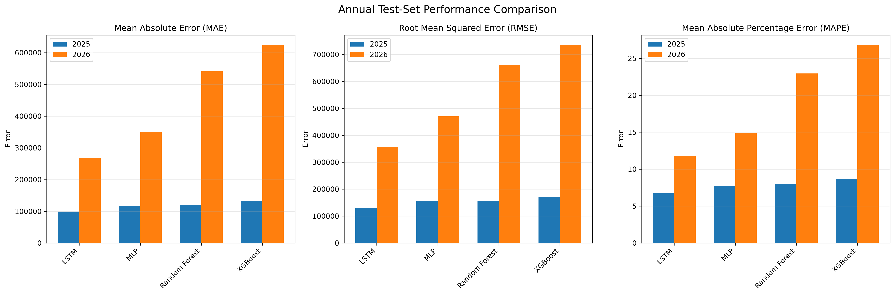

Figure 33. Annual test-period performance comparison.

## 4. Discussion

The exploratory analysis and stationarity tests indicate that daily Ethereum transaction counts are highly variable and that the original series is not stationary under the reported ADF and KPSS results. First-order differencing substantially changed the statistical properties of the series and was supported by both tests. Weekly dependence was also visible in the diagnostics, but the combined ordinary and seasonal differencing results suggested a risk of over-differencing.

The seasonal-naïve benchmark was materially stronger than the naïve benchmark and all tested ARIMA/SARIMA candidates in the fixed-origin validation comparison. The best SARIMA model by AIC/BIC was not the best SARIMA model by validation error. This reinforces the importance of out-of-sample evaluation alongside in-sample information criteria.

The machine-learning comparisons depend strongly on the forecast protocol. Fixed-origin forecasts require models to project farther into the validation horizon without access to subsequent actual observations, whereas rolling-origin forecasts update the input history after each one-step prediction. The resulting metrics should not be interpreted as a direct head-to-head comparison of the same prediction task.

LSTM was the weakest of the four machine-learning and deep-learning models during rolling-origin validation but the strongest of those four during the final test period. This reversal is an empirical observation; the present analysis does not establish a causal explanation. Likewise, all four models had higher errors in the 2026 test segment than in the 2025 segment, but the analysis does not identify the reason for this increase.

The final test ranking should be interpreted within its scope. The benchmarks and statistical models were not included in the final test evaluation reported here, so it would be inaccurate to claim that LSTM outperformed every model family on the final test period.

## 5. Limitations

Several limitations should be considered. First, the target is a daily count from a particular BigQuery transaction table and does not represent every internal execution or all possible measures of Ethereum activity. Second, the data end on 17 November 2026, and the final test interval contains partial calendar years. Third, only the specified model configurations and feature sets were evaluated; broader hyperparameter searches or alternative architectures may produce different results. Fourth, the reported evaluation does not include statistical significance tests for differences between model errors. Fifth, the comparison across fixed-origin and rolling-origin procedures is not like-for-like because the information available to each forecast differs. Finally, the increase in errors during the 2026 segment is descriptive and no causal analysis was conducted.

## 6. Conclusion

This study evaluated daily Ethereum transaction-count forecasting over 4,066 observations from October 2015 to November 2026. The original series was non-stationary under the reported ADF and KPSS tests, while first-order differencing was supported as a practical transformation for statistical modelling. The seasonal-naïve benchmark provided a strong reference, and the statistical model rankings differed depending on whether information criteria or validation forecast errors were considered. Machine-learning performance varied with the forecast protocol. In the final rolling one-step-ahead test, LSTM achieved the lowest error among the four evaluated machine-learning and deep-learning models, although it had performed less well during rolling-origin validation. All four models experienced higher errors in the 2026 test segment. These results demonstrate the value of chronological evaluation and careful separation of forecast protocols, while leaving the causes of changing forecast difficulty for future investigation.

## 7. Future Research

Future work could extend the analysis by evaluating additional network-activity targets, such as gas usage, active addresses, contract creation, or transaction fees; incorporating protocol and calendar events as explanatory variables; testing additional seasonal and regime-aware models; conducting systematic hyperparameter optimization using nested chronological validation; and applying statistical tests or forecast-comparison procedures to assess whether observed performance differences are robust. A further study could also investigate the 2026 increase in forecast errors using change-point analysis and additional explanatory data, without assuming a cause in advance.

## Data and code availability

Project repository: https://github.com/jkisfahani/Ethereum_TimeSeries_Forecasting

The repository contains project notebooks, analysis outputs, and visualization assets. The figures in this report are embedded from the 33 PNG files supplied for this report.

## References

Box, G. E. P., Jenkins, G. M., Reinsel, G. C., & Ljung, G. M. (2015). Time series analysis: Forecasting and control (5th ed.). Wiley.

Breiman, L. (2001). Random forests. Machine Learning, 45(1), 5–32. https://doi.org/10.1023/A:1010933404324

Chen, T., & Guestrin, C. (2016). XGBoost: A scalable tree boosting system. In Proceedings of the 22nd ACM SIGKDD International Conference on Knowledge Discovery and Data Mining (pp. 785–794). Association for Computing Machinery. https://doi.org/10.1145/2939672.2939785

Dickey, D. A., & Fuller, W. A. (1979). Distribution of the estimators for autoregressive time series with a unit root. Journal of the American Statistical Association, 74(366a), 427–431. https://doi.org/10.1080/01621459.1979.10482531

Google Cloud. (n.d.). Dataset schemas | Blockchain Analytics. https://docs.cloud.google.com/blockchain-analytics/docs/schema

Hochreiter, S., & Schmidhuber, J. (1997). Long short-term memory. Neural Computation, 9(8), 1735–1780. https://doi.org/10.1162/neco.1997.9.8.1735

Hyndman, R. J., & Athanasopoulos, G. (2021). Forecasting: Principles and practice (3rd ed.). OTexts. https://otexts.com/fpp3/

Hyndman, R. J., & Koehler, A. B. (2006). Another look at measures of forecast accuracy. International Journal of Forecasting, 22(4), 679–688. https://doi.org/10.1016/j.ijforecast.2006.03.001

Kwiatkowski, D., Phillips, P. C. B., Schmidt, P., & Shin, Y. (1992). Testing the null hypothesis of stationarity against the alternative of a unit root: How sure are we that economic time series have a unit root? Journal of Econometrics, 54(1–3), 159–178. https://doi.org/10.1016/0304-4076(92)90104-Y

Rumelhart, D. E., Hinton, G. E., & Williams, R. J. (1986). Learning representations by back-propagating errors. Nature, 323, 533–536. https://doi.org/10.1038/323533a0
